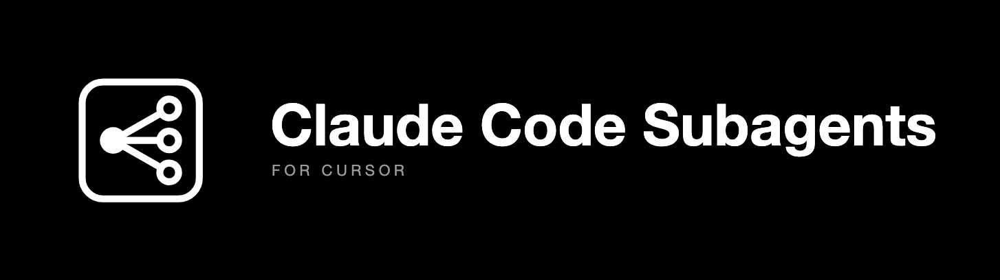

# Claude Code Subagents for Cursor



[](https://github.com/ysskrishna/claude-code-subagents-for-cursor/actions/workflows/validate.yml) [](https://github.com/ysskrishna/claude-code-subagents-for-cursor/actions/workflows/test-installs.yml) [](https://github.com/ysskrishna/claude-code-subagents-for-cursor/blob/main/LICENSE) [](https://github.com/ysskrishna/claude-code-subagents-for-cursor/releases) [](https://ysskrishna.space)

[](https://skills.sh/ysskrishna/claude-code-subagents-for-cursor) [](https://cursor.directory/plugins/claude-code-subagents-for-cursor)

A Cursor skill that runs your **custom subagents through Claude Code**, so each one runs on the `model:` written in its own agent file instead of the parent chat's model. Invoke it with `/use-claude-code-subagents`.

## Overview

In Cursor, custom subagents (`.cursor/agents/*.md`, `.claude/agents/*.md`, `.codex/agents/*.md`) declare a `model:` in their frontmatter, but the Task tool runs them on the **parent chat's model** in two cases:

- a **personal Anthropic API key (BYOK)** is on ([confirmed by Cursor staff](https://forum.cursor.com/t/opus-spawns-only-opus-subagents-despite-different-instructions/166870)), or
- the agent's model is not enabled in Cursor.

An agent you set up for Haiku then bills at Opus rates. Claude Code, run headlessly from Cursor's Shell tool, does honor the `model:` in agent files. This skill routes custom subagents through `claude -p` for the rest of the chat, and every run reports the model it actually ran on.

**You need:** Cursor desktop running locally (Cloud Agents have no `claude` CLI), Claude Code installed and signed in ([setup guide](https://code.claude.com/docs/en/setup)), and a POSIX shell (macOS, Linux). Runs bill your Claude Code account. The skill checks the Claude Code version for you.

## Installation

Pick one route. All of them install the same skill.

<a id="cursor-plugin"></a>

<details open>
<summary><b>Cursor plugin (recommended)</b></summary>

In Cursor, open **Customize, Plugins, Add, From GitHub Repository** and enter:

```text
github.com/ysskrishna/claude-code-subagents-for-cursor
```

Choose **user scope** to get the skill in every project, or project scope to commit it for a team. More in [docs/install/cursor-setup.md](docs/install/cursor-setup.md).

</details>

<a id="skillssh-npx-skills"></a>

<details>
<summary><b>skills.sh (npx skills)</b></summary>

```bash
npx skills add ysskrishna/claude-code-subagents-for-cursor -a cursor -g
```

Installs to `~/.agents/skills/`, which Cursor loads. Drop `-g` to install into the current project. Update with `npx skills update`. Remove with `npx skills remove use-claude-code-subagents`. More in [docs/install/skills-sh-setup.md](docs/install/skills-sh-setup.md).

</details>

<a id="github-cli-gh-skill"></a>

<details>
<summary><b>GitHub CLI (gh skill)</b></summary>

```bash
gh skill install ysskrishna/claude-code-subagents-for-cursor --all --agent cursor --scope user
```

Installs to `~/.cursor/skills/`. Without `--agent cursor`, `gh` installs for GitHub Copilot. Update with `gh skill update`. More in [docs/install/gh-cli-setup.md](docs/install/gh-cli-setup.md).

</details>

<a id="manual"></a>

<details>
<summary><b>Manual</b></summary>

Copy the [`skills/use-claude-code-subagents`](skills/use-claude-code-subagents) folder, including `references/`, to `~/.cursor/skills/` (user) or `<project>/.cursor/skills/` (project). More in [docs/install/manual-setup.md](docs/install/manual-setup.md).

</details>

## Usage

```text
/use-claude-code-subagents
```

The agent replies `Subagent mode: claude code`. From then on, each custom subagent you ask for runs through Claude Code on its own model, and the reply ends with a line like `scout ran on claude-haiku-5-5`. Say **"use cursor subagents"** to switch back to Cursor's Task tool.

More in [docs/guides/usage.md](docs/guides/usage.md): how the skill loads on its own, what to expect, and how to check it works. To try it on a ready-made project with two agents, see [examples/subagents](examples/subagents).

<a id="run-without-approval-prompts"></a>

<details>
<summary><b>Run without approval prompts</b></summary>

Claude Code runs outside Cursor's sandbox, so pick a run mode that allows it in Cursor Settings, Agents, Approvals & Execution:

- **Auto-Review (with Sandbox)**: suggested. Commands outside the sandbox go through a safety check.
- **Run Everything (Unsandboxed)**: no prompts at all, for projects you trust.

The Allowlist modes are not supported: they need an entry for every command. Briefs are written to a temp folder, not your repo. Details, other prompts (MCP tools, fetch) and trade-offs: [docs/guides/permissions.md](docs/guides/permissions.md).

</details>

## Documentation

| Guide | What is in it |
|---|---|
| [docs/README.md](docs/README.md) | Requirements, platforms, what is tested, when you do not need this |
| [docs/guides/usage.md](docs/guides/usage.md) | Using the skill, verifying it, what to expect |
| [docs/reference/how-it-works.md](docs/reference/how-it-works.md) | Agent lookup, model mapping, how the `claude` command is built |
| [docs/guides/permissions.md](docs/guides/permissions.md) | Run without approval prompts: Cursor run modes, Claude Code settings |
| [docs/guides/troubleshooting.md](docs/guides/troubleshooting.md) | Symptoms and fixes |
| [docs/reference/security.md](docs/reference/security.md) | What the skill can do, how it is limited, what to watch for |
| [docs/contributing/development.md](docs/contributing/development.md) | Check scripts, CI, releases |

Reporting a vulnerability: see [SECURITY.md](SECURITY.md).

## Built and maintained by

Claude Code Subagents for Cursor is built and maintained by:

| | Name | GitHub | Role |
|---|------|--------|------|
|  | **Y. Siva Sai Krishna** | [@ysskrishna](https://github.com/ysskrishna) | Creator |


## Changelog

See [CHANGELOG](https://github.com/ysskrishna/claude-code-subagents-for-cursor/blob/main/CHANGELOG.md) for release history.

## Support

If you find this library helpful:

- ⭐ Star the repository
- 🐛 Report issues
- 🔀 Submit pull requests
- 💝 [Sponsor on GitHub](https://github.com/sponsors/ysskrishna)

## License

MIT © [Y. Siva Sai Krishna](https://github.com/ysskrishna) — see [LICENSE](https://github.com/ysskrishna/claude-code-subagents-for-cursor/blob/main/LICENSE) for details.

---

<p align="left">
  <a href="https://github.com/ysskrishna">Author's GitHub</a> •
  <a href="https://linkedin.com/in/ysskrishna">Author's LinkedIn</a> •
  <a href="https://ysskrishna.space">Author's site</a> •
  <a href="https://github.com/ysskrishna/claude-code-subagents-for-cursor/issues">Report Issues</a>
</p>
